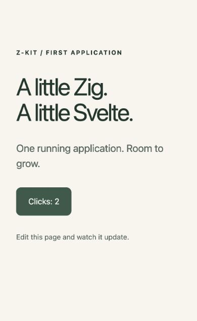

# Fresh applications through the Zig server

October 25, 2026. These are application demonstrations of the implemented
`zkit new` foundation, following the [feature specification](../../plans/first-application-spec.md)
and [source-backed plan](../../plans/upstream-application-creation.md).

## Creation, build and browser behavior

Toolchain: macOS ARM64, Zig `0.18.0-dev.543+fa4f5b262`, Node `24.22.1`,
VitePlus/Vite core `1.4.0`, managed pnpm `12.14.0`, sv `1.1.1`, Kit `3.1.0`,
Svelte `5.57.2`, Vitest `5.0.5`, Storybook `10.6.2`.

Every app below came from real VitePlus/sv creation in a fresh destination,
followed by real `sv add`, installation, Svelte checking and a root Zig/frontend
build. No generated app was manually repaired to make setup succeed.

| Application | Creation choices | Demonstrated result |
| --- | --- | --- |
| `final-empty` | `zkit new DESTINATION`, no supplied choices and no terminal | [Creation/build succeeded](final-empty-create.log). Omitted choices became minimal TypeScript. Browser loaded the ordinary Welcome to SvelteKit page through Zig on port 5182; [screenshot](final-empty.png). Its default unit/component tests [passed in Chromium](final-empty-tests.log). |
| `final-examples` | `-- --template demo --types jsdoc --add tailwindcss=plugins:none vitest=usages:unit` | [Creation/build succeeded](final-examples-create.log), invoked from `/tmp` using the installed CLI. The browser at Zig port 5186 displayed the shared z-kit page; clicking changed the counter to 2. Tailwind's stylesheet and plugin remained; stock demo routes were removed. Unit-only Vitest remained unit-only and passed; there was no component-browser installation step. |
| `empty-2` | Explicit minimal TypeScript, no optional add-ons | [First successful empty creation](empty-2-create.log); loaded through Zig on port 5182. Default unit/component suite and Storybook build passed. This predates the subsequent isolated Storybook installer/terminal-cleanup refinements. |
| `empty-repeat` | Existing empty destination, minimal TypeScript with upstream Playwright | [Repeated creation succeeded](empty-repeat-create.log). The upstream Playwright test [launched Zig itself and passed](playwright-through-zig.log), using the add-on's repaired public URL/root command. |
| `examples-2` | Demo TypeScript, no optional add-ons | [Repeated creation/build succeeded](examples-2-create.log). Started on Zig port 5184; browser counter changed from 0 to 1. [Start output](repeated-examples-start.log). |
| `interactive-final` | Terminal invocation with language supplied and template omitted | Displayed sv's real template chooser. Selected demo there; all subsequent setup completed without another build-approval prompt. Started on Zig port 5185 and the browser counter changed from 0 to 1. [Start output](interactive-start.log). |

The final empty and final examples creations both succeeded while the
framework checkout's `node_modules` was moved out of the resolution path.
The CLI's declared framework source location worked from another working
directory. The shared package store remained available, as in an ordinary
cached dependency install.



## Frontend HMR and the repository example

Edited `final-examples/web/src/routes/+page.svelte` while its page stayed open
at `http://127.0.0.1:5186`. Its displayed introduction changed to
“Fresh examples: HMR through Zig.” without a navigation. The browser recorded
`[vite] hot updated: /src/routes/+page.svelte` from the same public address.
[Screenshot](final-examples-hmr.png), [browser logs](browser.log),
[host output](final-examples-start.log). Restored the page afterward.
Component state reset during the edit; state preservation is not claimed.

The repository example separately rendered through Zig on port 5181,
hydrated (counter 0 → 1), and received a source edit through Vite HMR at that
same address. [Repository HMR screenshot](repository-hmr.png) and browser
logs retain that observation. Its source was restored afterward.

## Independent installation and rebuild

For the JSDoc/Tailwind/unit-only examples application, removed its own
`node_modules`, `.svelte-kit`, build output, Zig cache/output and Storybook
output. Also moved the framework checkout's `node_modules` away. Then ran
the generated README's root commands:

```sh
zig build install-web
zig build check
zig build
zig build dev -- --port 5183
```

[Install/check/build output](fresh-clone.log) shows a frozen-lockfile install,
zero Svelte errors/warnings, successful configured frontend checks and an
actual Kit build. The browser loaded the restored application through Zig
and clicking changed its counter to 1; [screenshot](fresh-clone-counter.png).
This app relies on the explicit source dependency in its `build.zig.zon`,
not framework frontend dependencies or pre-generated app artifacts.

## Ownership, failure and cleanup

- [Listener inventory](listeners.log): Zig alone owned the five public
  verification ports. [Socket inventory](vite-socket.log): Vite owned its
  private Unix-domain socket. Browser assets, JavaScript and HMR passed through Zig.
- [Occupied port](occupied-port.log) failed explicitly and did not announce
  readiness or silently choose another address.
- [Nonempty destination](nonempty.log) was refused before scaffolding.
- [Injected upstream failure](upstream-failure.log) reported the creation
  stage and upstream exit 42, returned failure and removed temporary root
  package-manager metadata.
- [Injected successful no-op sv add](unapplied-addon.log) returned zero
  without decorating the frontend. The CLI detected the missing integration,
  returned failure and did not write a usable native scaffold or print success.
  Injection wrappers are retained under `../../fixtures/`; these cases test
  failures and are not substitutes for the real application runs above.
- [Cancellation](cancellation.log) at sv's actual template chooser returned
  failure with an upstream-creation diagnostic, removed temporary metadata
  and printed no created-application message.
- [Cleanup observations](cleanup.log) show all five browser verification
  sessions removed their socket directories. Terminal hangup handling and
  bounded cancellation-protected cleanup fix the initially observed stale
  socket directories.
- [Lifecycle checks](lifecycle.log) restarted **both final starters twice on
  their same respective ports**, observed HTTP 200, interrupted the process
  group and verified removal of each session directory. Per-cycle output is
  retained alongside the summary. No owned Vite/host processes remained.

## Regression and tooling checks

- Root [Zig checks](zig-tests.log): host/CLI compilation, focused CLI behavior
  tests, existing projector tests and comptime proof passed. Cached existing
  projector results were reused when their inputs did not change.
- Repository [Svelte check](repository-check.log) passed; rebuilding the
  [tracked add-on bundle](addon-build.log) reproduced the same bundle used by
  the generated applications.
- Final empty [Vitest](final-empty-tests.log): two tests, including Chromium
  component testing, passed. Final examples [Vitest](final-examples-tests.log):
  the chosen unit-only test passed.
- [Empty Storybook](empty-storybook.log) and
  [final examples Storybook](final-examples-storybook.log) built successfully
  with VitePlus 1.4.0. The precise optional-peer allowance is scoped to this
  qualified pair; it is not a blanket ignored-peer rule.
- Upstream default fixtures can produce VitePlus lint warnings (an empty
  library index and an unawaited render in its component test). Checks and
  tests pass. Ordinary adapter-auto emits its production-target warning;
  standalone production serving is outside this foundation.

Native remotes, native loads, backend reloads and a production renderer are
not implemented or claimed. Research/failed setup attempts were excluded
from successful-app evidence. Temporary generated apps and installed outputs
were removed after proof collection; source, concise logs and screenshots
are retained here. The framework's original dependency directory was restored.
